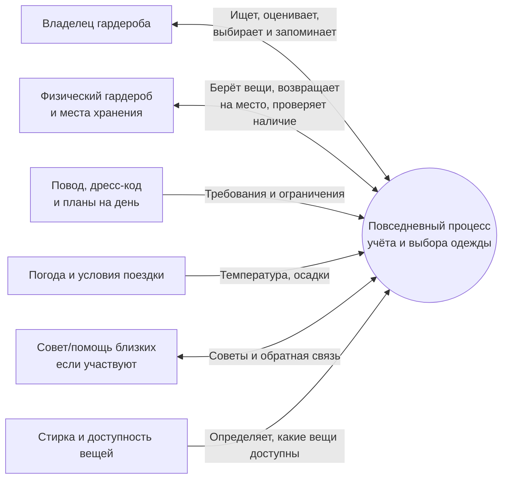

# Контекстная диаграмма нынешней системы

Диаграмма описывает процесс до внедрения AI Closet Inventory. Необязательные участники (близкие, заметки или фотографии) включаются в окончательную схему только после подтверждения, что ими действительно пользуются.
