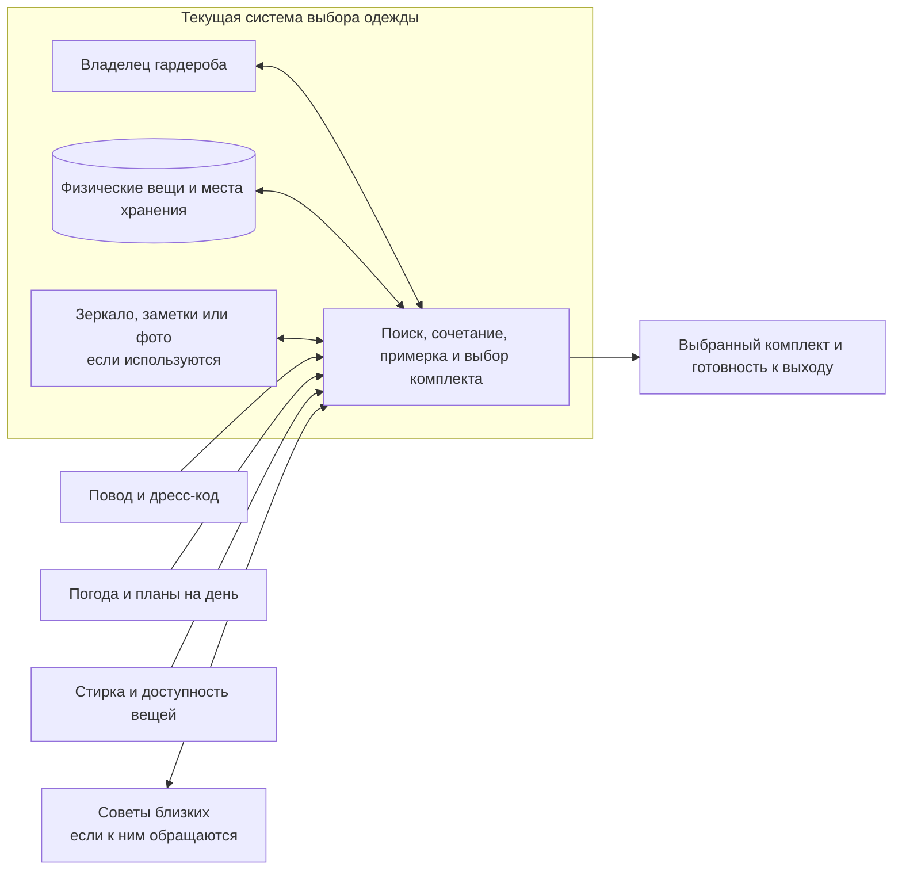

# 2. Контекст текущей системы

## Пояснения

- В центре — не приложение, а повторяющийся процесс, в котором владелец использует собственный гардероб для выбора одежды.
- Вещи и места хранения включены: без них невозможно выполнить поиск и проверить доступность предметов.
- Повод, погода, планы и стирка влияют на выбор, но сами не выбирают комплект, поэтому показаны как среда.
- Зеркало, заметки, фотографии и советы включаются только если наблюдение подтвердит их использование в конкретной практике.
- AI Closet Inventory не изображён: это предполагаемый будущий продукт, а не часть процесса «как есть».
