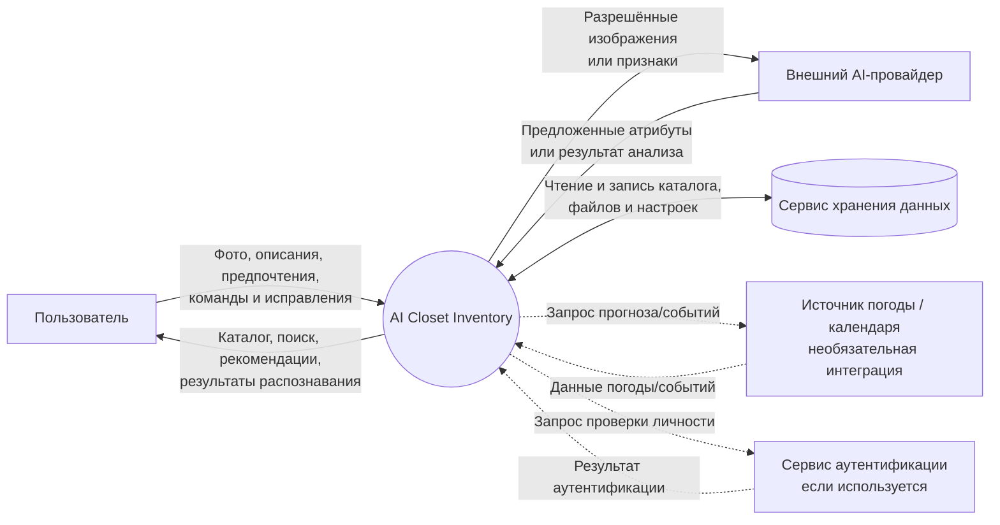

# 2. Контекстная диаграмма

## Пояснения

1. Центральный узел — разрабатываемая система AI Closet Inventory.
2. Пользователь находится за границей системы и взаимодействует через пользовательский интерфейс.
3. AI-провайдер — внешняя зависимость, если автоматическое распознавание выполняется через сторонний сервис.
4. Хранилище показано как внешняя система логически. При встроенной базе данных физическая граница развёртывания может отличаться, но ответственность за сохранение каталога остаётся у приложения.
5. Погода, календарь и сторонняя аутентификация обозначены пунктиром, потому что это необязательные интеграции и их наличие нужно подтвердить.
