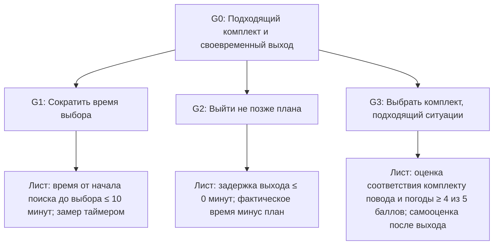

# 2. Дерево целей и показатели

## Цель системы

**G0. Выбрать подходящий к ситуации комплект из доступных вещей не более чем за 10 минут и выйти не позже запланированного времени.**

Цель продолжает формулировку лабораторной №1. Порог 10 минут — рабочий критерий этой работы, а не универсальная норма. Ветки дерева имеют разную глубину: дальнейшая декомпозиция не нужна там, где уже заданы показатель, единица измерения и способ сбора.

## Дерево

## Показатели листьев и исходные данные

| Лист | Показатель и единица | Целевое значение | Как получить число | Исходные данные лабораторной №1 |
|---|---|---|---|---|
| L1. Время выбора | Минуты от начала поиска одежды до окончательного выбора | Не более 10 минут на эпизод | Замерить таймером в каждом эпизоде | 9, 7 и 18 минут; целевое время достигнуто в 2 из 3 эпизодов |
| L2. Своевременность выхода | Минуты задержки: фактическое время выхода минус запланированное | 0 минут или меньше | Сравнить фактическое и запланированное время выхода | Вовремя — 1 из 3; в двух остальных эпизодах задержка около 3 и 5 минут |
| L3. Уместность комплекта | Баллы самооценки по шкале 1–5 | Не менее 4 баллов | После выхода попросить оценить соответствие комплекту повода и погоде | Не измерялась; исходного значения нет |

Для L3 оценка 1 означает «совсем не подходит», 3 — «частично подходит», 5 — «полностью подходит»; оценки 2 и 4 — промежуточные. Это предлагаемая шкала сбора будущих наблюдений, а не данные лабораторной №1.

Цель G0 считается достигнутой в эпизоде, только если одновременно выполнены L1 и L2, а комплект получил оценку по L3. Для лабораторной №1 нет оценки уместности, поэтому по трем эпизодам нельзя утверждать, что все условия G0 выполнены: наблюдения подтверждают только время выбора и своевременность выхода.