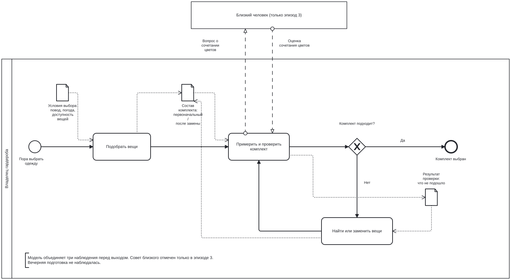

# Лабораторная работа №3. Процесс как он есть

**Проект:** AI Closet Inventory. **Процесс:** выбор одежды из домашнего гардероба перед выходом.

[Модель BPMN](clothing-as-is.bpmn) · [Экспорт схемы](clothing-as-is.svg)

## Официальное описание и личное правило

**Официального описания этого бытового процесса нет:** письменный регламент, инструкция или приказ о выборе одежды отсутствуют. Источник этого уточнения — владелец гардероба, автор работы. При уточнении он подтвердил: «Да, это моё личное правило; письменного регламента нет».

Его личное правило — **«собирать комплект с вечера»**. Это не регламент организации и не договорённость с другим человеком. Правило известно самому владельцу; он применяет его как ориентир для собственных сборов. Подробную последовательность действий, исключения на случай смены погоды и способ проверки готовности автор при уточнении не описывал.

Для сравнения беру ожидаемый результат этого правила: основной выбор одежды завершён накануне, перед выходом комплект не приходится заново искать или менять. Последняя формулировка — моя интерпретация цели правила, а не дополнительная инструкция. Сравнить фактический процесс с официальным регламентом нельзя, поскольку такого регламента нет.

## Где, когда и сколько раз наблюдали

Основа модели — **три наблюдения** за выбором вещей из домашнего гардероба. Место процесса — дома, у мест хранения одежды; в третьем эпизоде использовалось зеркало. Даты, действия и результаты взяты из [полевых наблюдений лабораторной №1](../lab1_boundaries_ai_closet_inventory/docs/01-system-boundary.md#полевые-наблюдения).

| Наблюдение | Действия перед выходом | Результат |
| --- | --- | --- |
| [Эпизод 1](../lab1_boundaries_ai_closet_inventory/docs/01-system-boundary.md#эпизод-1--обычное-утро-перед-работой): 20 октября, около 07:00, сборы на работу | Заменил примеренную футболку, проверил чистоту кофты, нашёл её на полке и выбрал куртку. | Около 9 минут, вышел вовремя. |
| [Эпизод 2](../lab1_boundaries_ai_closet_inventory/docs/01-system-boundary.md#эпизод-2--выход-в-дождливую-погоду): 21 октября, около 16:30, поход в магазин | После усиления дождя заменил кроссовки непромокаемой обувью, а ветровку — курткой с капюшоном. | Около 7 минут, вышел примерно на 3 минуты позже плана. |
| [Эпизод 3](../lab1_boundaries_ai_closet_inventory/docs/01-system-boundary.md#эпизод-3--сборы-на-день-рождения): 24 октября, около 17:00, сборы на день рождения | Примерил комплект у зеркала, заменил рубашку футболкой, выбрал одну из двух пар обуви и попросил близкого оценить цвета. | Около 18 минут, вышел примерно на 5 минут позже плана. |

Вечерняя подготовка в этих записях не наблюдалась. Я не знаю, что именно было собрано накануне каждого эпизода. Поэтому повторный выбор перед выходом нельзя считать доказательством того, что личное правило вечером не выполнялось.

## Расхождения с личным правилом и предполагаемые причины

С официальной инструкцией расхождений не устанавливаю: её нет. Ниже сравниваю **ожидаемый результат личного правила** с конкретными наблюдениями. Гипотезы о причинах отделены от фактов и пока не подтверждены отдельным наблюдением вечерней подготовки.

| Ожидаемый результат правила | Что видно в наблюдении | Почему человеку могло понадобиться отойти от заранее принятого решения — гипотеза |
| --- | --- | --- |
| Нужные вещи уже выбраны и доступны перед выходом. | Эпизод 1: во время утренних сборов пришлось проверить чистоту кофты и найти её на полке. | Если вечером человек только наметил комплект, но не проверил состояние и местонахождение вещей, подготовка могла оказаться недостаточной. Поиск и проверку приходится перенести на утро, потому что без чистой и найденной вещи выйти в выбранном комплекте нельзя. Было ли именно так накануне, неизвестно. |
| Основной состав комплекта сохраняется до выхода. | Эпизод 2: усилившийся дождь привёл к замене и обуви, и верхней одежды. | Решение, принятое раньше, может перестать подходить изменившимся условиям. Сохранить его означало бы выйти в менее подходящих для дождя вещах. Правило само по себе не помогает выбрать запасной вариант; это возможная причина повторного выбора, а не доказанная причина нарушения вечерней подготовки. |
| Окончательное решение о комплекте принято заранее. | Эпизод 3: после примерки рубашку заменили футболкой, выбирали обувь и обратились за оценкой цветов. | Если вечером не примерить комплект целиком, ощущение излишней официальности может обнаружиться только у зеркала перед выходом. Человек пересматривает решение, потому что хочет чувствовать себя уместно на событии; одного заранее выбранного списка вещей для этого недостаточно. Было ли отсутствие вечерней примерки причиной в этом эпизоде, неизвестно. |

Эти гипотезы объясняют, **что могло мешать закончить выбор заранее**: непроверенная доступность вещей, изменение внешних условий и оценка образа только после примерки. Они не сводят отклонения к лени. Чтобы проверить их, в следующем наблюдении нужно проследить один комплект с вечера до выхода: что выбрано, что проверено, что изменилось и почему.

## Модель as-is: участники, действия и передаваемые данные

Процесс начинается с необходимости выбрать одежду и заканчивается окончательным выбором комплекта. Вечерняя подготовка находится за границей этой модели: её не наблюдали. AI Closet Inventory в процесс не включён, поскольку в описанных эпизодах приложение не использовалось.

- **Пул «Владелец гардероба»** содержит наблюдаемые действия: подобрать вещи, примерить и проверить комплект, при необходимости найти или заменить вещи и повторить проверку. Развилка «Комплект подходит?» имеет исходы «Да» и «Нет».
- **Пул «Близкий человек»** обозначает внешнего участника. Его внутренние действия не детализированы: зафиксировано только обращение за оценкой цветов в эпизоде 3. Потоки сообщений подписаны «Вопрос о сочетании цветов» и «Оценка сочетания цветов». В эпизодах 1 и 2 этого обмена не было.
- **Объект данных «Условия выбора»** содержит сведения о поводе, погоде и доступности вещей, используемые при подборе.
- **Объект данных «Состав комплекта»** передаётся от подбора к проверке и обновляется при замене вещей.
- **Объект данных «Результат проверки»** передаёт от проверки к поиску или замене сведения о том, что не подошло: состояние вещи, защита от дождя или внешний вид. Пунктирные связи с объектами — ассоциации данных, сплошные стрелки — порядок действий.

Объекты данных показывают сведения, которыми человек пользуется в бытовом процессе. Это не утверждение о существовании электронных документов, учётной системы или записей в приложении. Выбранные вещи остаются физическими вещами, а объект «Состав комплекта» обозначает информацию о выборе.

## Где процесс задерживается

Во всех трёх эпизодах был поиск, замена или повторный выбор хотя бы одной вещи перед выходом. В модели этому соответствует возврат от развилки через «Найти или заменить вещи» к повторной проверке.

Самый долгий эпизод — сборы на день рождения, около 18 минут. В нём были примерка, замена рубашки, выбор обуви и обращение за советом. Отдельные шаги не замерялись, поэтому нельзя утверждать, сколько времени занял каждый из них или что главным источником задержки был совет близкого.

Модель отредактирована через API редактора [bpmn-js Modeler](https://bpmn.io/toolkit/bpmn-js/walkthrough/); SVG экспортирован из этой же сохранённой модели.

Проверено повторным открытием в bpmn-js: предупреждений импорта нет, все 26 видимых элементов и связей отрисованы. В XML есть два участника, два потока сообщений, три объекта данных и шесть ассоциаций данных. Ссылки между элементами модели и локальные ссылки записки разрешаются. Повторный экспорт SVG совпадает с приложенным изображением с точностью до служебных идентификаторов маркеров. Настольный Camunda Modeler в этой проверке не запускался.

[Задание](https://github.com/ChS23/system-analysis-course/blob/main/lab3_process/README.md) · [Лекция 5](https://github.com/ChS23/system-analysis-course/blob/main/lectures/05-Инструментарий%20системного%20аналитика.md)
